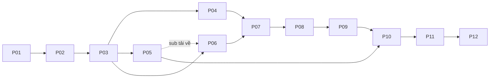

# Fonesi Edit — Kế hoạch triển khai 12 phase

Phiên bản: 1.1 — 27/10/2026. Trạng thái: đã triển khai code độc lập xuyên P03–P12; đang nghiệm thu local, cổng bên ngoài giữ mở. Xem CURRENT_STATUS.md. Bản 1.1 bổ sung quản lý công cụ và đăng nhập Chrome thật, giữ 12 phase.

Nguồn yêu cầu: [PRODUCT_REQUIREMENTS.md](PRODUCT_REQUIREMENTS.md), [EDITOR_SPEC.md](EDITOR_SPEC.md), [SETTINGS_AND_BROWSER_SPEC.md](SETTINGS_AND_BROWSER_SPEC.md). Tài liệu kèm theo: [thiết kế kỹ thuật](TECHNICAL_DESIGN.md), [đối chiếu yêu cầu](REQUIREMENTS_TRACEABILITY.md), [ma trận nền tảng](PLATFORM_SUPPORT_MATRIX.md).

## 1. Cách chia phase

12 phase thay cho 7 mốc M0–M6 trước đây. Tách riêng preview, hiệu ứng/render, batch, ma trận, tự động hóa và nghiệm thu để kiểm tra từng phần. Giữ toàn bộ phạm vi đã thống nhất; TTS/ASR/OCR/tracking tự động ở bản mở rộng sau.

| Phase | Kết quả chính | Phụ thuộc để hoàn tất | Trạng thái |
| --- | --- | --- | --- |
| P01 | Đặc tả triển khai, luồng màn hình, dữ liệu và tiêu chí | Các đặc tả hiện có | Hoàn tất thiết kế — xem phases/P01_RESULTS.md |
| P02 | Kiểm chứng tải, dịch, preview, render, GPU, đóng gói sớm | P01 | Chưa qua cổng — xem phases/P02_RESULTS.md |
| P03 | Nền ứng dụng, project, database, hàng đợi, worker, registry tool/profile | Quyết định lõi P02 | Có code / QA local; xem CURRENT_STATUS.md |
| P04 | Workspace, preview, timeline, phím tắt, Cài đặt công cụ/tài khoản | P03, mẫu preview P02 | Có code / QA local; xem CURRENT_STATUS.md |
| P05 | Tải kênh/ảnh/video/sub, thư mục, chống trùng, Chrome/auth thực tế | P03, kết quả nguồn P02 | Có code / QA local; xem CURRENT_STATUS.md |
| P06 | Dịch, sửa, chèn phụ đề và song ngữ | P03–P05; làm sub cục bộ trước được | Có code / QA local; xem CURRENT_STATUS.md |
| P07 | Font/logo/chữ/che chữ, chuyển động, render thống nhất | P04, mô hình sub P06 | Có code / QA local; xem CURRENT_STATUS.md |
| P08 | Edit hàng loạt, âm thanh, khớp thời lượng | P06–P07 | Có code / QA local; xem CURRENT_STATUS.md |
| P09 | Cảnh/góc, ma trận, chống trùng, render tổ hợp | P08; thuật toán thuần làm sau P03 được | Có code / QA local; xem CURRENT_STATUS.md |
| P10 | Chuỗi auto, lịch chạy, watcher, tài nguyên thích ứng | P05–P09 | Có code / QA local; xem CURRENT_STATUS.md |
| P11 | Tích hợp, phục hồi, hiệu năng, đối chiếu đủ tùy chọn | P04–P10 | Có code / QA local; xem CURRENT_STATUS.md |
| P12 | Bản Windows, nghiệm thu máy thật, hướng dẫn | P11 và cổng phát hành | Có code / QA local; xem CURRENT_STATUS.md |

Số phase không phải số ngày. Chỉ ước lượng tiến độ sau P02 khi biết engine, mức hỗ trợ nguồn, máy mục tiêu và rủi ro đóng gói.

## 2. Quy tắc điều hành

**Điều chỉnh theo chỉ đạo tiếp tục của người dùng:** triển khai liên tục các phần độc lập qua P03–P12 bằng nền CPU/Qt đã kiểm chứng. Các cổng live network/API/Windows/Chrome/GPU còn thiếu được giữ mở riêng; không chặn code không phụ thuộc và không đánh dấu nghiệm thu bên ngoài là đã đạt.

- Mỗi đầu việc có ID, phạm vi, phụ thuộc, hiện vật bàn giao và bằng chứng hoàn thành. Không chọn checklist trước khi thực hiện.
- Trạng thái: chưa bắt đầu / đang làm / bị chặn / cần sửa / hoàn tất có bằng chứng. Một connector có điều kiện không đồng nghĩa toàn phase hoàn tất.
- Mỗi lát cắt code có đường chạy thật và nối được vào app. Dữ liệu giả chỉ phục vụ phát triển, gắn nhãn; không thay bằng chứng tải/dịch/render.
- Kiểm thử ở từng phase; P11 là tích hợp/độ bền, không đợi đến P11 mới kiểm tra.
- Một nguồn thiếu tài khoản không chặn editor/sub cục bộ/batch/ma trận. Ghi blocker theo connector và không đánh dấu phần bị chặn là hoàn tất.
- Không thêm tính năng mới giữa phase mà không cập nhật đặc tả và đối chiếu. Tùy chọn đã thống nhất vẫn là phạm vi cần theo dõi.
- Giữ nguồn, không gọi API tính phí chưa cấu hình, không lưu bí mật trong project/log. Job dùng snapshot cấu hình bất biến.
- Cloud/Linux hỗ trợ logic và CLI; nghiệm thu Windows/GPU Windows cần môi trường tương ứng.

## 3. P01 — Đặc tả triển khai và luồng sử dụng

**Mục tiêu:** chuyển danh sách chức năng thành màn hình, dữ liệu và tình huống code được.

- [x] P01-01: đánh mã yêu cầu, tách phạm vi hiện tại/tích hợp sau; ghi mặc định và trường hợp lỗi.
- [x] P01-02: wireframe bảy khu vực, media/preview/inspector/timeline, Cơ bản/Nâng cao, trạng thái rỗng/đang làm/lỗi.
- [x] P01-03: luồng thêm kênh, folder, âm thanh, chỉnh sub/logo, ma trận và hàng đợi; đếm thao tác đường dùng thường xuyên.
- [x] P01-04: preset từng nhóm, một clip/nhiều clip/cả lô; thuộc tính khóa và ghi đè tay.
- [x] P01-05: định nghĩa W/K, ưu tiên khớp âm thanh, thiếu sub, tên logic, trùng tên và tệp đã xử lý.
- [x] P01-06: corpus media, nguồn thử, quyền truy cập/cấu hình cần, tiêu chí và phép đo preview/export.
- [x] P01-07: hợp đồng project/preset/job, module và sổ quyết định cần thực nghiệm ở P02.
- [x] P01-08: wireframe Cài đặt công cụ/hồ sơ Chrome/tài khoản mọi nền tảng, luồng scan→download/install→check, login→verify→use; readiness ba trục.

**Bàn giao:** wireframe, luồng, hợp đồng bản đầu, bảng truy vết đủ phạm vi.

**Cổng hoàn tất:** mọi nhóm có nơi thao tác, mặc định, phase và tiêu chí; không mâu thuẫn giữa các tab.

## 4. P02 — Kiểm chứng rủi ro trước khi làm lớn

**Mục tiêu:** chọn công cụ bằng kết quả chạy, đặc biệt preview và Windows packaging.

- [ ] P02-01: ghi toolchain/máy/OS/codec/filter/encoder/font; lấy công cụ từ nguồn tin cậy, giữ TLS/checksum/chữ ký, pin sau kiểm chứng.
- [ ] P02-02: thử yt-dlp/gallery-dl trên nguồn công khai và nguồn có cấu hình đăng nhập; quét nhiều trang, tải video/ảnh/sub theo bảng nền tảng.
- [ ] P02-03: thử dịch Trung–Việt với thuật ngữ/tên riêng/câu dài; so chất lượng, tốc độ, chi phí, cache và quota.
- [ ] P02-04: so engine preview cho Qt; mẫu alpha logo, chữ Việt/Trung, blur, seek, waveform, keyframe, audio; so mốc với FFmpeg export.
- [ ] P02-05: thử CPU/encoder GPU thật, phân biệt encode GPU và filter CPU; đo RAM/VRAM và fallback.
- [ ] P02-06: bản đóng gói Windows thử: mở UI, media/font/sub, FFmpeg, Unicode, startup. Không để P12 mới thử đóng gói.
- [ ] P02-07: benchmark có máy/mẫu; chốt ngân sách UI/proxy/seek, sai số hình/thời gian và mức song song ban đầu trước P04/P07.
- [ ] P02-08: ghi quyết định provider dịch, preview, FFmpeg build, packaging; blocker cho Windows/nguồn chưa truy cập được.
- [ ] P02-09: thử discovery/tool manifest, nguồn Windows đáng tin, đường dẫn tùy chỉnh/version/capability, tải-cài-verify và rollback khi job đang dùng bản cũ.
- [ ] P02-10: Google Chrome chính thức trên Windows, hồ sơ độc lập, nhiều nền tảng/một hồ sơ và nhiều nick cùng nền tảng khác hồ sơ; kiểm chứng session handoff vào downloader với Chrome đang mở, mã hóa hiện tại và account mismatch.

**Bàn giao:** mẫu chạy thật, video mẫu, báo cáo khả năng/benchmark, quyết định có phiên bản và blocker.

**Cổng hoàn tất:** video+sub → dịch → logo/che chữ → xuất chạy thật; preview/packaging và đường cài tool/dùng phiên Chrome có bằng chứng trên hệ mục tiêu. Phần chưa có bằng chứng vẫn bị chặn; CLI Linux không thay nghiệm thu Windows, đăng nhập web không thay kiểm chứng downloader dùng phiên.

## 5. P03 — Nền ứng dụng, dữ liệu và hàng đợi

- [ ] P03-01: scaffold module, môi trường tái lập, dependency lock, config và user data tách khỏi thư mục chương trình.
- [ ] P03-02: schema/version/migration cho project/media/preset/job/artifact/history/cache; backup và phục hồi khi migration lỗi.
- [ ] P03-03: probe, ID/fingerprint, rational timestamp/time map; media không audio hoặc metadata lỗi.
- [ ] P03-04: scheduler/worker process, công đoạn/progress/cancel/pause/retry, quản lý tiến trình con trên Windows và lease phục hồi sau crash.
- [ ] P03-05: snapshot cấu hình/seed, log lọc bí mật, phân loại lỗi và UI hàng đợi đầu tiên.
- [ ] P03-06: output tạm → kiểm tra → tên cuối an toàn, không đè; truy vết nguồn; bỏ output/cache khi quét.
- [ ] P03-07: save/autosave/recovery, relink media, cache theo fingerprint/phiên bản; thử đóng bất thường có kiểm soát.
- [ ] P03-08: dependency registry/resolver, tool ownership/version/path/capabilities, trusted manifests, cài per-user, staging/self-test/activation/lease/rollback, không đè tool ngoài.
- [ ] P03-09: schema BrowserProfile/PlatformAccountBinding, profile ownership/browser state/auth state, credential refs và account-scoped cache; không lưu cookie/mật khẩu trong project.

**Bàn giao:** app mở được, tạo/mở project, job cục bộ chạy qua worker có tiến độ thật.

**Cổng hoàn tất:** FFmpeg không khóa UI; mở lại giữ việc xong; worker lỗi không mất hàng đợi; tệp dở không thành công giả.

## 6. P04 — Workspace, preview và timeline nền

- [ ] P04-01: panel/theme/HiDPI/cỡ chữ UI, drag từ Explorer, media/inspector, slider/ô số/reset.
- [ ] P04-02: chọn/kéo/resize/xoay logo/chữ/vùng che, crop; neo/tọa độ tương đối, lưới/safe area/snap/Alt và đưa về khung.
- [ ] P04-03: đa chọn/nhóm/khóa/ẩn/thứ tự layer; tránh kéo nhầm; menu ngữ cảnh.
- [ ] P04-04: undo/redo, một drag một lệnh; inspector và canvas dùng cùng model, save/open giữ đúng.
- [ ] P04-05: timeline/playhead/trim/split/in-out/gap/ripple/marker, thumbnail/waveform, zoom/scroll/loop.
- [ ] P04-06: proxy/cache tạo nền, đổi chất lượng/cancel/invalidation, seek đồng bộ audio/video.
- [ ] P04-07: shortcut theo focus, remap/xung đột/trợ giúp; nhập Việt/Trung không kích hoạt player/canvas.
- [ ] P04-08: UI Cài đặt tool scan/path/check/download/install-all/update/repair/rollback có progress; Chrome/profile/account tables, Ctrl+, và readiness với nút khắc phục đúng lỗi.

**Bàn giao:** bản nội bộ chỉnh một clip trực tiếp; chưa gắn nhãn đủ hiệu ứng P07.

**Cổng hoàn tất:** zoom preview không đổi tọa độ; chỉnh cơ bản khớp bản xuất mẫu và phục hồi project; Delete không xóa tệp nguồn.

## 7. P05 — Tải đa nền tảng và tổ chức thư mục

Ba đợt kỹ thuật, không giảm phạm vi: A YouTube/Bilibili; B TikTok/Facebook/Instagram; C Threads/X/Douyin/Xiaohongshu/Kuaishou. Có thể đổi thứ tự theo P02 và nguồn truy cập được.

- [ ] P05-01: registry/capabilities, nhiều URL, bài/kênh/playlist, ID chuẩn và loại trùng.
- [ ] P05-02: phân trang/checkpoint, ảnh/video/Reels/Shorts/album khi nguồn hỗ trợ, lọc ngày/thời lượng/số lượng/chất lượng.
- [ ] P05-03: cây nội dung, chọn mục, tổng chưa biết/quét ngắt, cancel và tiếp tục khi hỗ trợ.
- [ ] P05-04: downloader/tệp tạm/validation, tốc độ/retry/rate limit/auth; không log cookie/token.
- [ ] P05-05: folder/kênh/album Unicode có ID, video/images/subtitles/metadata, thiếu đĩa/quyền ghi/tên dài/xung đột.
- [ ] P05-06: chống trùng theo ID/chất lượng/tệp hợp lệ; bổ sung sub riêng, tải lại tệp lỗi, đồng bộ lần hai và kênh đổi tên.
- [ ] P05-07: kiểm chứng nguồn/loại media/auth, lưu ngày/phiên bản/evidence. Thiếu quyền ghi blocker, không dùng mock để báo hỗ trợ.
- [ ] P05-08: profile manager mở Chrome thật vào đúng user-data-dir/nền tảng, tạo/đặt tên/gán nhiều nền tảng, tách nick cùng nền tảng, xử lý khóa/bận mà không phá profile.
- [ ] P05-09: session broker theo cơ chế đạt P02, đăng nhập/kiểm tra/đăng nhập lại cho mọi nền tảng, nhận diện nick, trạng thái website khác khả năng connector dùng phiên và quyền nguồn.
- [ ] P05-10: chọn account theo nguồn/job, nhớ mặc định, refresh cùng danh tính/resume, mismatch chặn đúng job; không silent fallback sang công khai hoặc tự xoay nick; auth cache không lẫn tài khoản.

**Bàn giao:** màn hình tải, tệp thật đúng folder, khả năng từng nguồn, đồng bộ thủ công; lịch ở P10.

**Cổng hoàn tất:** mọi tổ hợp được gắn hỗ trợ có phép thử thật; quét lại không tải trùng; không báo tải toàn kênh khi quét dở; job dùng đúng account/profile và kiểm chứng auth riêng từng nguồn. Nguồn còn chặn vẫn mở, không coi P05 đã đủ mọi nền tảng.

## 8. P06 — Phụ đề, dịch và trình sửa

- [ ] P06-01: SRT/VTT/ASS về cue chung, báo style chưa hỗ trợ; ghép bằng ID/ngôn ngữ/tên, báo mơ hồ.
- [ ] P06-02: nguồn/đích/ưu tiên, sub người đăng/tự động, chính sách thiếu sub và khác ngôn ngữ.
- [ ] P06-03: adapter dịch thật, thuật ngữ/xưng hô/tên riêng/ngữ cảnh, cache, chi phí/rate limit/retry.
- [ ] P06-04: gốc/dịch song song, sửa/tìm/thay/tách/gộp, dịch lại câu chọn, khóa câu đã sửa, lịch sử.
- [ ] P06-05: thời gian qua timeline/ô số, offset, kiểm tra chồng/tràn, time map sau trim/speed.
- [ ] P06-06: đơn/song ngữ, style cơ bản liên kết P07, xuất SRT/ASS và burn-in qua pipeline chung.

**Bàn giao:** video có sub dịch thật, editor và file sub; provider thiếu cấu hình hiển thị đúng, không giả dịch thành công.

**Cổng hoàn tất:** lô sub Việt/Trung/thiếu/lỗi không ghép nhầm, không chặn cả lô; đổi font không dịch lại; auto giữ sửa tay.

## 9. P07 — Tùy chọn phong phú, chuyển động và render thống nhất

- [ ] P07-01: font hệ thống/TTF/OTF riêng, tìm/yêu thích/mẫu/fallback/glyph/thiếu font; cùng font/layout preview-render.
- [ ] P07-02: chữ/viền/bóng/nền/padding/căn/giãn dòng/giãn chữ/ngắt dòng/nội dung động; nhiều logo, vị trí/lề/opacity/thời gian.
- [ ] P07-03: nhiều vùng blur/mosaic/màu, bo góc/cường độ/feather theo khả năng engine đã chứng minh; cảnh báo thuộc tính không khả dụng.
- [ ] P07-04: keyframe X/Y/scale/rotation/opacity, linear/easing, copy/paste, thời gian tuyệt đối/tương đối, playhead và undo.
- [ ] P07-05: chạy thẳng/chéo/A→B/nhiều điểm/qua góc/lặp/đi-về/nảy/zoom/xoay/fade; speed/duration/delay/hold/repeat/vùng.
- [ ] P07-06: random có seed/khoảng/xác suất, biến thể mỗi clip, vùng tránh/cảnh báo xung đột, giữ khóa tay.
- [ ] P07-07: fit/crop/nền/tỷ lệ/màu/flip/rotate/speed; thứ tự filter, time map sub, capability CPU/GPU.
- [ ] P07-08: compiler từ model chung, đối chiếu frame, progress FFmpeg/cancel/validation; tối ưu một lần encode khi có thể, ghi lý do cần intermediate.

**Bàn giao:** editor nhiều lựa chọn và export có kiểm tra.

**Cổng hoàn tất:** vị trí/font/layer/keyframe/thời gian khớp preview-export trong dung sai P02; không có hiệu ứng chỉ xem được nhưng báo xuất thành công.

## 10. P08 — Edit hàng loạt và âm thanh

- [ ] P08-01: nhiều folder/đệ quy/checkbox/loại/đảo chọn/tìm/lọc, không xóa nguồn, không nhận output/cache.
- [ ] P08-02: preset/ghi đè clip/xem tác động/snapshot, output theo kênh/mẫu tên/phiên bản không đè.
- [ ] P08-03: tiếng gốc/âm chính/nhạc/SFX, mute/solo/gain/fade/trim/delay, meter/clipping/chuẩn hóa.
- [ ] P08-04: audio cả lô/theo tên/danh sách/random, nhạc lặp chuyển tiếp, SFX theo giây/cảnh/tỷ lệ, giảm nhạc theo chính sách hỗ trợ.
- [ ] P08-05: duration planner một hoặc nhiều clip; đích video/audio/nhập tay, min/max speed/đoạn, giữ cao độ, lặp/freeze/cắt theo lựa chọn.
- [ ] P08-06: tính chuyển cảnh/audio crossfade vào thời lượng, time map sub; báo bất khả thi, không tự bỏ cảnh/ghép clip ngoài chế độ.
- [ ] P08-07: chạy thử một video/đoạn, ước tính dung lượng/ETA, render lô/resume, kiểm tra duration/tracks/media.

**Bàn giao:** bản nội bộ edit một folder/nhiều kênh có preview và output thật.

**Cổng hoàn tất:** khác độ dài/tỷ lệ/audio vẫn đúng chính sách, tên/folder đúng, lỗi một tệp không làm lại lô.

## 11. P09 — Cảnh, ma trận và chống trùng

- [ ] P09-01: quét C1…Cn/G1…Gm, natural sort/đổi thứ tự/khóa/loại, ID ổn định/tên logic; đổi tên thật có ánh xạ hoàn tác riêng.
- [ ] P09-02: tích tổ hợp/lọc/history dự án/hash góc/tổ hợp; phân biệt reservation và đầu ra thành công.
- [ ] P09-03: generator seed/không trùng/cân bằng/W/K, phạm vi so sánh, timeout/cancel, chưa tìm đủ khác bất khả thi.
- [ ] P09-04: bảng sửa/khóa ô/tạo lại hàng/preview/chuỗi C1G1+C2G2+…/thống kê/CSV; sửa hàng phải kiểm tra lại ràng buộc.
- [ ] P09-05: chia đều/tỷ lệ/trọng số/nhập tay, dùng duration planner P08, tính chuyển cảnh, giữ đủ/thứ tự.
- [ ] P09-06: render/validation theo hàng, snapshot nguồn/góc/preset/seed, commit lịch sử sau output hợp lệ, retry không sinh tổ hợp mới ngầm.

**Bàn giao:** tạo/render nhiều đầu ra theo ma trận, tái tạo được.

**Cổng hoàn tất:** đối chiếu tập nhỏ với toàn bộ tổ hợp; tập lớn không tạo cả tích trong RAM; không nới W/K; đổi tên tệp không vượt chống trùng.

## 12. P10 — Auto và quản lý tài nguyên

- [ ] P10-01: DAG tải→sub→dịch→edit→render→validation theo lô/cuốn chiếu, công đoạn idempotent/trạng thái riêng.
- [ ] P10-02: lịch đồng bộ/watcher đợi tệp ổn định/loại output, chống job trùng/chạy chồng, chính sách lịch bỏ lỡ; chạy khi app đóng cần chế độ nền/Windows Task Scheduler được bật rõ.
- [ ] P10-03: kênh→logo/preset/output, auto layout có giới hạn, chạy lại riêng nhóm/giữ sửa tay/dry-run.
- [ ] P10-04: CPU/RAM/GPU/VRAM/đĩa, Êm/Cân bằng/Tối đa, giới hạn riêng quét/tải/dịch/render/luồng mỗi việc.
- [ ] P10-05: benchmark gợi ý, giữ tài nguyên dự phòng/backpressure/giảm nhận việc, phục hồi có ngưỡng tránh dao động; encode khác filter GPU.
- [ ] P10-06: ETA/tốc độ/công đoạn/lô, ưu tiên/đổi job chờ/thông báo, hành động sau xong do người dùng bật, dọn cache an toàn.
- [ ] P10-07: preflight tool/Chrome/session/quyền nguồn, lease tool/profile và giới hạn theo account/domain; login lại đúng nick rồi resume, cập nhật tool không đụng job đang chạy, không dọn browser data như cache.

**Bàn giao:** workflow đã cấu hình chạy không cần thao tác lại từng bước.

**Cổng hoàn tất:** không vòng watcher hoặc tự tạo job trùng khi mở lại; request dịch có kết quả chưa rõ được đối chiếu/chờ theo chính sách thay vì retry vô điều kiện; không mất sửa tay; thiếu tài nguyên có lý do và UI vẫn phản hồi.

## 13. P11 — Độ bền, hiệu năng và đủ phạm vi

- [ ] P11-01: end-to-end các workflow/nguồn hỗ trợ; dọc/ngang/CFR/VFR/rotation/audio lệch hoặc không audio/sub sau speed-trim.
- [ ] P11-02: crash worker/app/mạng/auth/rate limit/quota/tệp hỏng/thiếu font-media/quyền ghi-đĩa đầy; retry/resume.
- [ ] P11-03: lô lớn/nhiều layer/ma trận lớn/tải+render; đo UI/proxy/seek/RAM/VRAM/rò tài nguyên trên máy tham chiếu.
- [ ] P11-04: đối chiếu frame/sub/audio/duration theo dung sai; sửa nguyên nhân, không tắt kiểm tra để đạt.
- [ ] P11-05: rà mọi hàng truy vết, mọi tùy chọn/phím tắt/focus/HiDPI/theme/persistence/preset migration.
- [ ] P11-06: nguồn có phiên bản/ngày/evidence, tách lỗi app/hạn chế nguồn/blocker cấu hình; không đóng mục chưa chạy thành công.
- [ ] P11-07: log/backup/cache/dependency, lỗi còn lại theo mức ảnh hưởng và cách khắc phục.
- [ ] P11-08: missing/wrong tools, installer ngắt/verify lỗi/quyền ghi/update bận; Chrome A nhiều nền tảng, Chrome B nick khác, phiên hết hạn/challenge/mismatch/lock/bridge không dùng được, export không chứa session.

**Bàn giao:** báo cáo nghiệm thu nội bộ, benchmark có điều kiện, lỗi/giới hạn minh bạch.

**Cổng hoàn tất:** không lỗi mất dữ liệu/sai tổ hợp-ngôn ngữ/thành công giả; mỗi yêu cầu có evidence hoặc blocker rõ. Blocker chức năng bắt buộc ngăn tuyên bố đã đủ toàn phạm vi.

## 14. P12 — Đóng gói và bàn giao Windows

- [ ] P12-01: đóng gói tái lập theo P02, FFmpeg/thư viện/font hợp lệ; chạy không cần bộ dev/admin nếu không thiết yếu.
- [ ] P12-02: phân biệt install/user data, Unicode/quyền ghi/antivirus thực tế, CPU-only và GPU phù hợp khi có.
- [ ] P12-03: chạy workflow từ bản đóng gói, save/open/crash/restart/migration/cấu hình thiếu, mở kết quả bằng player ngoài.
- [ ] P12-04: hướng dẫn Việt, preset mẫu, cấu hình dịch/phiên nguồn an toàn, phím tắt/chẩn đoán/báo lỗi.
- [ ] P12-05: cập nhật tool/adapter có version/xác minh/tương thích/rollback, backup trước đổi schema.
- [ ] P12-06: manifest, capabilities, máy thật, release notes/giới hạn, lưu bản phục hồi.
- [ ] P12-07: Windows mới thiếu dependency/Chrome: từ Cài đặt tải-cài-kiểm tra, mở Chrome thật/login, dùng phiên tải mẫu; tool ngoại không bị sửa, offline vẫn dùng media cục bộ, giới hạn auth được ghi đúng.

**Bàn giao:** bản dùng cá nhân Windows và hồ sơ kiểm chứng. Bản nội bộ giới hạn giao sớm được với nhãn đúng phạm vi.

**Cổng hoàn tất:** workflow từ bản đóng gói chạy thật trên máy mục tiêu; đóng gói xong không đồng nghĩa mọi nguồn hoạt động. Thiếu nguồn phải ghi rõ bản còn giới hạn.

## 15. Các bản nội bộ để đánh giá

| Bản | Sau phase | Đánh giá được |
| --- | --- | --- |
| A | P04 | Bố cục/kéo thả/timeline/phím tắt/lưu project |
| B | P05–P07 | Nguồn đã đạt, dịch/chèn sub, thuộc tính editor/export |
| C | P08 | Edit hàng loạt và âm thanh từ folder |
| D | P09 | Ma trận/chống trùng/render theo cảnh |
| E | P10 | Workflow auto và tài nguyên |
| Dùng thật | P11–P12 | Độ bền/Windows/đóng gói/nguồn có bằng chứng |

Các bản A–E không mang nhãn đầy đủ phần chưa làm. Qua phase chỉ khi đạt cổng tương ứng.

## 16. Phụ thuộc và tiếp tục khi bị chặn

- Thứ tự mặc định P01→P12. Nhánh độc lập tiếp tục khi connector chặn; không cần triển khai nhiều agent.
- Thiếu API dịch: làm parser/editor/sub gốc/render/adapter; không coi dịch đã đạt.
- Thiếu Windows/GPU: làm logic/pipeline CPU, giữ cổng nghiệm thu nền tảng mở, không ghi GPU đã đạt.
- Nguồn lỗi: dùng media cục bộ cho editor/batch/ma trận, giữ việc tích hợp nguồn trong bảng.
- Blocker ghi phép thử lỗi, prerequisite thiếu, phase ảnh hưởng, việc tiếp tục được và điều kiện retry.

## 17. Ước lượng và phát hành

- Sau P02 mới ước lượng theo đầu việc/số đo, cập nhật khi engine/nguồn thay đổi; 12 phase không có nghĩa 12 ngày.
- Chừa adapter/schema cho TTS/ASR/OCR/tracking, không xây tính năng giả hoặc mở rộng giữa lúc lõi chưa ổn định.
- Báo riêng code/test/đóng gói/Windows/nguồn. Hiện tài liệu chỉ chứng minh kế hoạch đã chuẩn bị.
